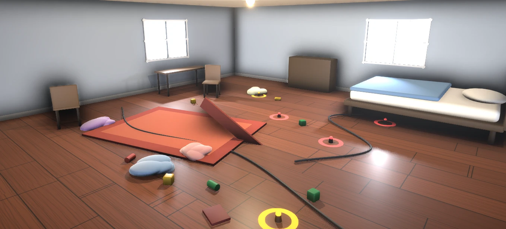

# 02 — Look Kit (the visual standard)

The look kit is the fixed rendering setup, materials and primitive API that every scene uses.
**Argon never edits the kit**; it only calls the kit API from building modules. This is what keeps
13 generated buildings consistent and good-looking.

## Reference



`argon-spec/assets/reference-bedroom.webp` — the target look for every **interior**. What makes it
work, and what we replicate:

| Quality | How |
|---|---|
| Warm, glossy wood floor with visible planks | Tileable plank texture, satin roughness 0.45, environment reflections |
| Soft, pale blue-grey walls with white baseboards | Matte plaster (roughness 0.9) + light trim strip at floor |
| Overexposed, glowing windows | Emissive window panels + bloom with a high threshold |
| Soft grounding shadows under every object | Ambient occlusion (GTAO) + soft shadow maps |
| Simple shapes that read as "designed" | Rounded boxes, cylinders, tubes; pastel fabric colors; clean silhouettes |
| Gentle overall exposure, no harsh contrast | ACES tone mapping, exposure 1.0, hemisphere fill, room environment map |
| Colored floor rings as interaction markers | Flat emissive rings (yellow primary, coral secondary) with a small center post |

Exteriors use the same materials and lighting philosophy in daylight: bright, soft, toy-like.

## Renderer (`kit/LookKit.ts`)

```ts
import * as THREE from 'three';
import { EffectComposer } from 'three/examples/jsm/postprocessing/EffectComposer.js';
import { RenderPass } from 'three/examples/jsm/postprocessing/RenderPass.js';
import { GTAOPass } from 'three/examples/jsm/postprocessing/GTAOPass.js';
import { UnrealBloomPass } from 'three/examples/jsm/postprocessing/UnrealBloomPass.js';
import { OutputPass } from 'three/examples/jsm/postprocessing/OutputPass.js';
import { RoomEnvironment } from 'three/examples/jsm/environments/RoomEnvironment.js';

export function createRenderer(canvas: HTMLCanvasElement, q: QualitySettings) {
  const renderer = new THREE.WebGLRenderer({ canvas, antialias: false, powerPreference: 'high-performance' });
  renderer.outputColorSpace = THREE.SRGBColorSpace;
  renderer.toneMapping = THREE.ACESFilmicToneMapping;
  renderer.toneMappingExposure = 1.0;
  renderer.shadowMap.enabled = q.shadows;
  renderer.shadowMap.type = THREE.PCFSoftShadowMap;
  renderer.setPixelRatio(Math.min(window.devicePixelRatio, q.pixelRatioCap));
  return renderer;
}

export function createComposer(renderer, scene, camera, w, h, q: QualitySettings) {
  const target = new THREE.WebGLRenderTarget(w, h, { samples: q.msaaSamples, type: THREE.HalfFloatType });
  const composer = new EffectComposer(renderer, target);
  composer.addPass(new RenderPass(scene, camera));
  if (q.ao) {
    const gtao = new GTAOPass(scene, camera, w, h);
    gtao.updateGtaoMaterial({ radius: 0.6, distanceExponent: 1.2, thickness: 1.0, scale: 1.0 });
    gtao.blendIntensity = 0.85;
    composer.addPass(gtao);
  }
  if (q.bloom) composer.addPass(new UnrealBloomPass(new THREE.Vector2(w, h), 0.35, 0.6, 0.92));
  composer.addPass(new OutputPass());
  return composer;
}

export function applyEnvironment(renderer, scene) {
  const pmrem = new THREE.PMREMGenerator(renderer);
  scene.environment = pmrem.fromScene(new RoomEnvironment(), 0.04).texture;
  pmrem.dispose();
}
```

API details of `GTAOPass.updateGtaoMaterial` and pass constructors may differ by Three.js version —
check the installed `three/examples/jsm` sources and adjust here only.

## Quality tiers (`engine/Quality.ts`)

| Setting | High | Medium | Low |
|---|---|---|---|
| `pixelRatioCap` | 1.5 | 1.0 | 0.85 |
| `msaaSamples` | 4 | 2 | 0 |
| `shadows` | true (2048 map) | true (1024 map) | false |
| `ao` (GTAO) | true | false | false |
| `bloom` | true | true | false |
| Fog far | 420 | 360 | 300 |
| Tree count | 100% | 70% | 40% |

`auto`: start High; after 120 frames in the city, if mean frame time > 22 ms → Medium; re-measure;
if still > 22 ms → Low. Persist choice in `localStorage['foundry.quality']`.

## Lighting presets (`kit/lights.ts`)

**Interior (`interiorLights(room)`):**
- `HemisphereLight(sky #DFE8F5, ground #6B4A33, intensity 0.6)`.
- `DirectionalLight(#FFF1DC, 2.2)` coming through the first window (positioned 6 m outside the
  window, aimed at room center), `castShadow`, shadow map per quality, `shadow.bias = -0.0004`,
  `shadow.normalBias = 0.02`, shadow camera bounds ±10.
- Ceiling lamp: small emissive disc (`#FFE9C7`, emissiveIntensity 3) at the ceiling center +
  `PointLight(#FFE2B8, 18, 14, 2)` without shadows.
- Up to 3 extra lights from the module (`k.light`), no shadows.

**Exterior (`cityLights()`):**
- `HemisphereLight(sky #CFE3F7, ground #7DBF5A, 0.7)`.
- Sun: `DirectionalLight(#FFF1DC, 2.6)` from direction `(-0.45, -0.8, -0.35)` (normalized), shadow
  map per quality, shadow camera ±60 m **centered on the player** (update every frame: move light
  and target with the player, snapped to 1 m to avoid shimmer).
- Sky: background vertical gradient (top `#8FBCE6` → horizon `#E9F1F8`) via a large inverted
  sphere with a 2-color shader; `scene.fog = new THREE.Fog('#E3ECF4', 120, fogFar)`.

## Materials (`kit/materials.ts`)

All `MeshStandardMaterial` unless noted; `envMapIntensity` 0.7 unless noted. Textures from
`/generated/textures/<name>.png` with procedural canvas fallbacks (`kit/textures.ts`);
`colorSpace = SRGBColorSpace` for color maps; `wrapS/T = RepeatWrapping`; `anisotropy = 8`.

| Key | Color | Map (meters per tile) | Roughness | Metalness | Notes |
|---|---|---|---|---|---|
| `wood_floor` | `#9A5A35` | `wood_planks` (2.0) | 0.45 | 0 | envMapIntensity 0.9 |
| `wood_dark` | `#5A3A25` | — | 0.6 | 0 | furniture |
| `wood_light` | `#C8A37A` | — | 0.55 | 0 | furniture |
| `plaster_wall` | `#AEB8C5` | `plaster` (3.0) | 0.9 | 0 | |
| `plaster_warm` | `#E8DCC8` | `plaster` (3.0) | 0.9 | 0 | |
| `trim` | `#F2EFEA` | — | 0.6 | 0 | baseboards, frames |
| `brick` | `#B5654A` | `brick` (2.0) | 0.85 | 0 | exteriors |
| `stucco` | `#EFE6D8` | `plaster` (4.0) | 0.95 | 0 | exteriors |
| `roof` | `#3D4250` | `roof_tiles` (2.0) | 0.7 | 0 | |
| `roof_red` | `#A4483A` | `roof_tiles` (2.0) | 0.7 | 0 | |
| `plaza_stone` | `#C9C4BA` | `cobblestone` (3.0) | 0.9 | 0 | |
| `road` | `#3B3D42` | `asphalt` (6.0) | 0.95 | 0 | |
| `lane_marking` | `#F2EFEA` | — | 0.8 | 0 | |
| `grass` | `#7DBF5A` | `grass` (4.0) | 1.0 | 0 | |
| `metal_dark` | `#2E3238` | — | 0.4 | 0.6 | |
| `metal_light` | `#B8BEC6` | — | 0.3 | 0.8 | |
| `glass` | `#CFE6F5` | — | 0.05 | 0 | `transparent`, opacity 0.35, depthWrite false |
| `window_glow` | `#FFFFFF` | — | 1.0 | 0 | emissive `#FFFFFF`, emissiveIntensity 2.2 (blooms) |
| `screen` | `#1E2C40` | — | 0.3 | 0 | emissive `#3A6EA5` 0.6 |
| `paper` | `#F7F3EA` | — | 0.95 | 0 | |
| `fabric_lavender` | `#B9A6E6` | `fabric` (0.5) | 0.95 | 0 | |
| `fabric_blue` | `#A7C4EE` | `fabric` (0.5) | 0.95 | 0 | |
| `fabric_pink` | `#F2B8C6` | `fabric` (0.5) | 0.95 | 0 | |
| `fabric_cream` | `#F1E9DA` | `fabric` (0.5) | 0.95 | 0 | |
| `fabric_coral` | `#E2714B` | — | 0.95 | 0 | rugs |
| `fabric_coral_dark` | `#C4502E` | — | 0.95 | 0 | rug borders |
| `cable` | `#1E1F22` | — | 0.5 | 0 | |
| `plant` | `#4F8F4A` | — | 0.8 | 0 | |
| `pot` | `#C87D5A` | — | 0.7 | 0 | |
| `accent` | department color | — | 0.6 | 0 | resolved per building |
| `accent_dark` | department color × 0.7 | — | 0.6 | 0 | |
| `ring_primary` | `#F5D90A` | — | 0.4 | 0 | emissive same, 1.2; `MeshBasicMaterial` acceptable |
| `ring_secondary` | `#F07272` | — | 0.4 | 0 | emissive same, 1.0 |

Materials are created once and shared (a `Map<MaterialKey, Material>` per accent color).

## Interaction ring (`kit/primitives.ts: interactionRing`)

`RingGeometry(0.75, 0.95, 48)` laid flat at y = 0.012 + a center post `CylinderGeometry(0.08, 0.1,
0.18)` + a soft glow disc `CircleGeometry(1.1)` with additive blending at opacity 0.18. Pulse:
scale `1 + 0.04·sin(3t)`. Yellow for agents and the car; coral for exits/doors.

## Interior shell (built by the kit, not the module)

Room 18 m (x: −9…9) × 14 m (z: −7…7) × 4.2 m. Floor `wood_floor` (or the module's
`interiorShell.floor`), walls `plaster_wall` (or override), ceiling `plaster_warm`, baseboard
strip 0.12 m tall × 0.03 m deep in `trim`. Entrance door opening on the south wall (z = +7) at
x = 0, 1.6 m wide × 2.5 m tall, with a `trim` frame, and an exit ring (coral) at `(0, 0, 6.2)`.
Player spawn `(0, 1.65, 5.4)` facing −Z.

## DESIGN.md

[`../templates/DESIGN.md`](../templates/DESIGN.md) restates these rules in prose for Argon and is
included in every worldgen and critic prompt.
